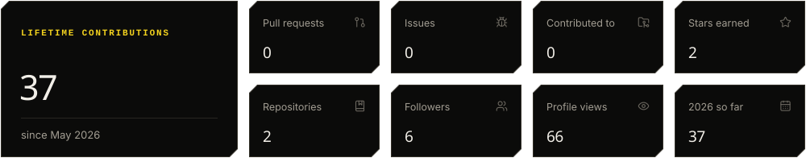
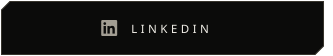
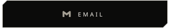
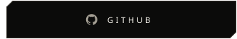
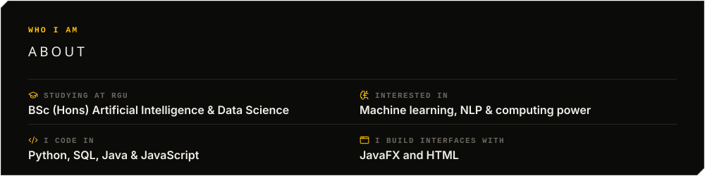
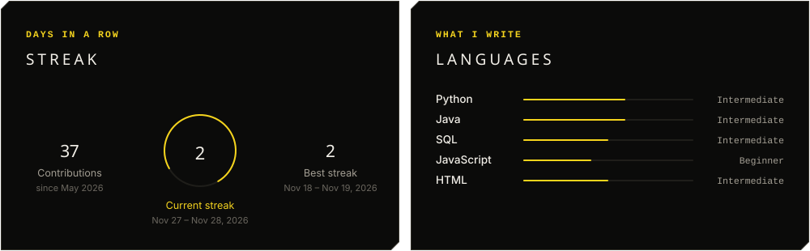
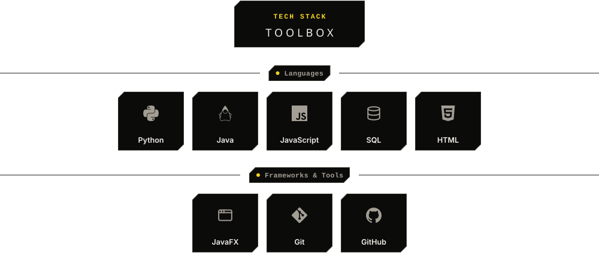
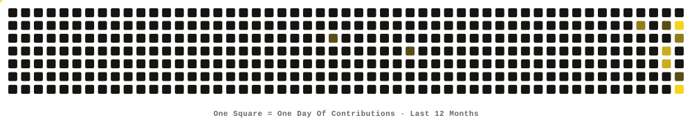
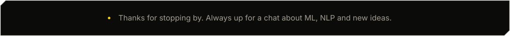

<!-- Artwork in assets/ is drawn by .github/scripts/draw_assets.py (edit its CONTENT block and re-run it).
     The stats, streak and languages panels and the snake are redrawn hourly by .github/workflows/profile-assets.yml
     into the `output` branch; the languages list itself lives in .github/scripts/stat_cards.py (KNOWN_LANGUAGES).
     Accent colour: one line in .github/scripts/theme.py (ACCENT). -->

<!-- Projects: add them to PROJECTS in draw_assets.py, re-run it, then uncomment and fill in:

-->

<!-- invisible counter that records profile views; the stats above read its total -->

